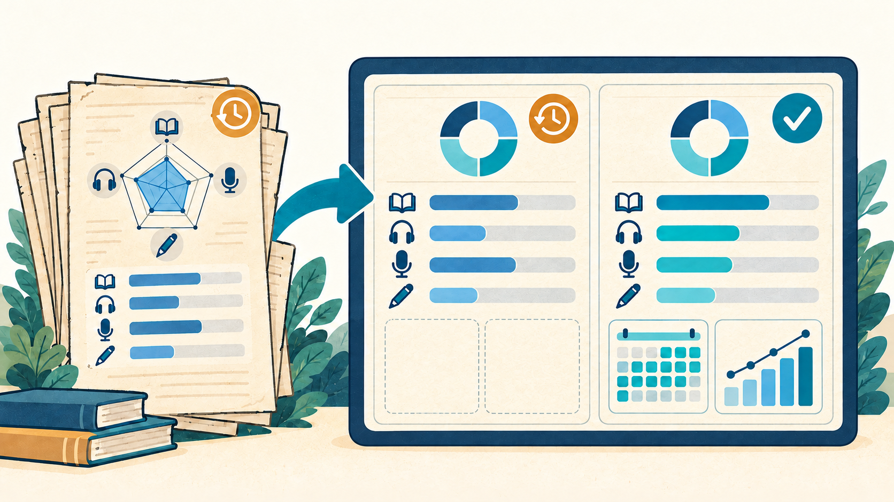
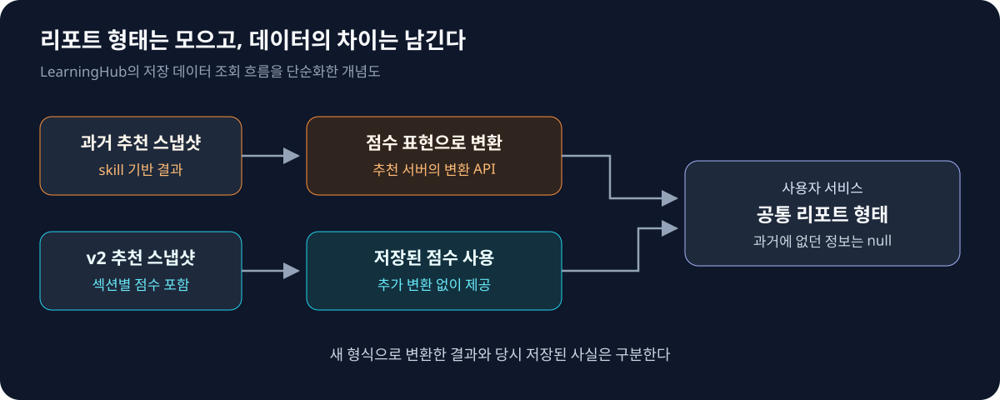

`API Evolution` `Backward Compatibility` `Snapshot` `Sealed Type` `Data Migration`

추천 API를 새 버전으로 바꾸면, 사용자가 지난달에 받았던 학습 리포트는 어떻게 보여줘야 할까?

Santa TOEFL의 추천학습을 전환하면서 가장 고민했던 것은 과거 리포트였다. 새 화면으로 통합하되, 당시 저장하지 않은 정보까지 만들어 보여주고 싶지는 않았다.

## 사용자가 이해할 수 있는 점수로 바꾸기

기존에는 자체 skill 점수를 제공했지만, 사용자 인터뷰와 이용 통계에서 이 체계에 대한 인지가 낮다는 점을 확인했다. 그래서 익숙한 TOEFL 섹션별 점수로 현재 수준과 취약 영역을 보여주기로 했다.

추천 서버의 결과가 바뀌면서, 이를 저장하는 LearningHub와 학습 화면에 연결하는 사용자 서비스도 함께 전환해야 했다.

## 과거 리포트는 그대로 두면 되지 않을까

백엔드에서는 v1·v2 리포트를 따로 제공하는 편이 간단했다. 하지만 추천 계약이 바뀔 때마다 프론트엔드가 관리할 템플릿과 분기가 늘어난다.

당장의 구현보다 이후의 유지 비용을 고려해, 과거 추천도 새 리포트 형태로 제공하기로 했다.

## 같은 리포트 형태가 같은 정보량을 뜻하지는 않는다

점수 해석을 담당하는 추천 서버에 변환 API를 두었다. LearningHub는 과거 skill 결과를 이 API로 변환하고, 이미 점수가 있는 v2 추천은 그대로 사용했다.

과거에 없던 권장 학습량과 추천 지표는 `null`로 남겼다. 현재 설정으로 채우면 그때도 같은 추천을 했던 것처럼 보이기 때문이다. **리포트 형태를 통합해도, 과거에 없던 정보까지 채우지는 않았다.**

## null을 허용하자, 빠지면 안 되는 값도 빠질 수 있었다

과거 리포트에서 추천 지표가 없는 것은 정상이다. 하지만 새 추천으로 학습 화면을 구성할 때는 같은 지표가 반드시 필요하다. 하나의 nullable DTO로는 이 둘을 구분하기 어려웠다.

그래서 스냅샷을 sealed 타입과 하위 데이터 클래스로 나누고, 종류별 필수 값을 생성 시 검증했다. 과거 데이터를 읽기 위한 예외가 신규 추천의 필수 조건까지 느슨하게 만들지 않도록 했다.

## 엔드포인트보다 기존 사용자의 상태를 따라 검증했다

v2 경로를 먼저 추가하고 소비처를 옮긴 뒤, 사용자 서비스의 v1 경로를 정리했다.

검증 기준은 기존 사용자가 새 추천학습을 이어갈 수 있는지였다. 온보딩만 마친 경우, 진단고사까지 마친 경우, 이미 추천학습을 진행한 경우로 나눠 정상 동작을 확인했다.

## 변환 API는 전환 비용을 옮긴 선택이었다

리포트 템플릿을 통합한 대신, 과거 skill 체계를 해석하는 비용은 추천 서버에 남았다. 변환 API는 임시 경로로 두고, 필요한 변환 결과를 데이터에 채운 뒤 제거하는 것을 후속 과제로 잡았다.

이번 전환에서는 화면을 통합하면서도 데이터의 차이는 모델에 남겼다. 그래야 과거 기록을 계속 보여주면서 새 추천의 필수 조건도 지킬 수 있었다.
